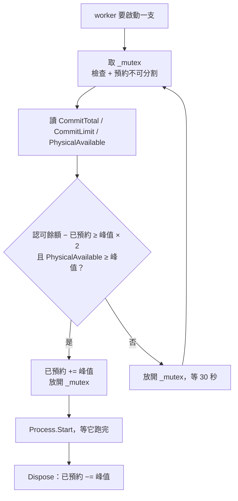

主程式要對 50 個客戶各拉一支子 process 跑匯出，同時開幾支才不會把機器弄垮？

想回答這題，得先能回答一個更基本的問題：**現在這台機器，還塞不塞得下一支？**

## 寧可不啟動，也不要中途死

這題有兩種答法，差別在你願不願意讓 process 死在半路。

一種是「先開再說，死了再處理」：用 Job Object 給子 process 設記憶體上限，讓失控的那支自己爆，主程式看 exit code、退避重試、重跑一次。

另一種是**把關在啟動之前**：算不夠就根本不啟動，讓它在佇列裡等，等到有空間再放行。

如果子 process 做的事中途死掉會留下爛攤子，就只有第二種可以走：

- 匯出寫到一半的檔案，下游可能已經讀走了
- 已經打給外部系統的請求收不回來，重跑變成重複扣款、重複發信
- 跨系統的流程不是一個交易，rollback 沒有想像中萬能
- 工作不是冪等的，「重跑一次」這個動作本身就不安全

對這類任務，**「啟動」本身就是一個不可逆的決定** — 按下去就得讓它跑完。所以判斷必須放在 `Process.Start` 之前，而且寧可保守到讓它多等，也不要放行一支跑到八成才因為配置失敗倒下的工作。

想靠 `try/catch` 接住 `OutOfMemoryException` 再優雅收尾，也不可靠。例外是在配置失敗的當下丟出來的，而收尾程式碼自己也要記憶體 — 組訊息字串、寫 log、回寫狀態，每一步都可能再撞一次同樣的牆。記憶體真的見底時，最不能指望的就是善後的那段程式。

這篇講的是第二種做法：在 Windows 上，啟動之前該讀哪個數字、怎麼讀、門檻怎麼抓。

## 三個數字，只有一個管用

工作管理員的記憶體頁面上數字一大把，跟「還能不能再開一支」有關的是三個：

| 數字 | 是什麼 | 能不能拿來判斷 |
|---|---|---|
| 工作集 (working set) | 現在實際佔著實體記憶體的部分 | 不行 |
| 可用實體記憶體 | `GlobalMemoryStatusEx` 的 `ullAvailPhys` | 不行 |
| **認可量 (commit charge)** | 全機（所有 process 加上核心自己）跟系統要走、系統承諾給它的總額度 | **可以** |

工作集不行，是因為它會自己縮水。機器一吃緊，OS 就把冷掉的頁換到分頁檔，工作集的數字跟著往下掉 — 明明壓力變大，看起來反而變輕鬆。

可用實體記憶體不行，理由跟直覺不太一樣。`ullAvailPhys` 的官方定義是「standby、free、zero 三張清單的總和」— 可回收的檔案快取（standby list）**已經算在可用裡了**，它不像 Linux 的 `free` 那樣把快取誤報成已用。

它真正的問題是**跟「配置會不會失敗」沒有綁在一起**。一支 process 可以 commit 4 GB、卻只實際碰過 100 MB，那 3.9 GB 在可用實體記憶體上幾乎看不出來，認可量卻早就扣掉了。機器離配置失敗只剩一步，這個數字還顯示一切健康 — 拿它把關，會在最該擋的時候放行。

認可量是唯一有**硬天花板**的數字。

Windows 對一般的桌面與伺服器 process 沒有 OOM killer：記憶體不夠時它不會挑一支殺掉，而是把東西往分頁檔換，整機一起慢下來。（UWP 應用與 Modern Standby 下的情況不同，那些會被系統終止，但排程跑的 console app 不在此列。）

真正會出事的那一刻，是認可總量頂到認可上限。這時下一次配置直接失敗，誰剛好在要記憶體誰倒楣 — 在 .NET 裡就是一個 `OutOfMemoryException`。

```
認可上限 ≈ 實體記憶體 + 分頁檔大小
```

寫成約等於，是因為核心會先保留一部分，實際值比那個和略小；而且分頁檔設成「系統管理大小」時它還會自己長大，是個會浮動的天花板。工作管理員「效能 > 記憶體」左下角那行「已認可 12.3/32.0 GB」，就是認可總量跟認可上限。

所以整件事只剩一個問題：**再開一支，認可量會加上多少？加上去之後還在天花板底下嗎？** 這需要兩個數字：一支要走多少、機器還剩多少。分頭量。

## 量一支要走多少

先問需求側：一支要走多少。這個數字 `Process` 物件直接有，趁它還活著的時候取樣：

```csharp
var startInfo = new ProcessStartInfo("exporter.exe", "CUST-001")
{
    UseShellExecute = false,
    CreateNoWindow = true,
};

using var process = Process.Start(startInfo)!;

long peakBytes = 0;

while (!process.WaitForExit(1000))
{
    process.Refresh();   // 不呼叫的話，讀到的永遠是第一次查到的快照
    peakBytes = Math.Max(peakBytes, process.PeakPagedMemorySize64);
}

Console.WriteLine($"峰值私有認可量：{peakBytes / 1024 / 1024} MB");
```

名字裡的 `Paged` 很容易誤會成「被換到分頁檔的量」，它不是。這個屬性對應的是 Win32 的 `PagefileUsage`，實際意思是這支 process 的**私有認可量 (private commit)** — 它跟系統要走的私有額度，跟分頁檔有沒有真的被用到無關。它是這支 process 對主機認可總量的貢獻，跟下一節要讀的總量方向一致、量級可比，拿來估「再開一支會多吃多少」剛好。但別期待把每支加起來會等於主機的認可總量 — 總量裡還有核心自己的認可（分頁／非分頁集區、page table、kernel stack）與共用的部分。

**要趁 process 還活著的時候讀**，這是最容易踩的坑。.NET 的 `Process` 屬性不是從它握著的 handle 拿資料，而是拿 PID 去列舉系統中的 process；process 一結束就列舉不到，再讀會丟 `InvalidOperationException`，而且訊息是「No process information is available」而不是「Process has exited」，第一次遇到會查很久。`Refresh()` 也不能省，`Process` 會把第一次查到的快照留著不動。Microsoft Learn 上這個屬性的官方範例就是這樣寫的：在迴圈裡取值存進區域變數，離開 `using` 之後才印出來。

真的想在 process 結束之後才拿最終值，就得自己走 handle 那條路 — P/Invoke `GetProcessMemoryInfo`，讀 `PROCESS_MEMORY_COUNTERS.PeakPagefileUsage`。只要 handle 還開著，核心就會保留這個 process 物件，結束後仍然查得到；而用 PID 去查還有 PID 被重用、查到另一支同號 process 的風險。

要在程式外面看，perfmon 的對應計數器是 `\Process(exporter)\Page File Bytes Peak` — 不是 `Private Bytes`，那個對應的是 `PrivateMemorySize64`，是另一個欄位。PowerShell 同樣得趁它活著的時候問：

```powershell
Get-Process exporter | Select-Object Name, @{ n = 'CommitPeakMB'; e = { $_.PeakPagedMemorySize64 / 1MB } }
```

**挑最壞的輸入來量。** 拿最小的客戶量出 80 MB，實際上最大的那個客戶吃 900 MB，後面所有算式都是假的。量出來的值寫進設定檔，換一台機器或換一版工具就是改個數字的事。

## 讀主機現在的認可量

再問供給側：機器目前的認可總量與上限，用 `GetPerformanceInfo`：

```csharp
[StructLayout(LayoutKind.Sequential)]
private struct PERFORMANCE_INFORMATION
{
    public uint cb;
    public nuint CommitTotal;        // 已認可（單位：頁）
    public nuint CommitLimit;        // 認可上限（單位：頁）
    public nuint CommitPeak;
    public nuint PhysicalTotal;
    public nuint PhysicalAvailable;
    public nuint SystemCache;
    public nuint KernelTotal;
    public nuint KernelPaged;
    public nuint KernelNonpaged;
    public nuint PageSize;           // 每頁多少 bytes，一般是 4096
    public uint HandleCount;
    public uint ProcessCount;
    public uint ThreadCount;
}

[DllImport("psapi.dll", SetLastError = true)]
[return: MarshalAs(UnmanagedType.Bool)]
private static extern bool GetPerformanceInfo(out PERFORMANCE_INFORMATION info, uint cb);
```

Windows 7 以後也可以直接指到 `kernel32.dll` 的 `K32GetPerformanceInfo`，.NET 7 以上則可以換成來源產生器版本的 `[LibraryImport]`。另外 `cb` 這個欄位跟 `MEMORYSTATUSEX.dwLength` 不一樣，不必自己填 — 大小是用第二個參數傳進去的，欄位由 API 自己回填，所以參數宣告成 `out` 沒有問題。

這幾個欄位的單位是**頁不是 bytes**，要自己乘 `PageSize`。包成一個好讀的型別：

```csharp
public readonly record struct CommitStatus(ulong Committed, ulong Limit, ulong PhysicalAvailable)
{
    // 認可上限還剩多少，見底就是配置失敗
    public ulong Headroom => Limit > Committed ? Limit - Committed : 0;
}

private static CommitStatus GetCommitStatus()
{
    var size = (uint)Marshal.SizeOf<PERFORMANCE_INFORMATION>();

    if (!GetPerformanceInfo(out var info, size))
        throw new Win32Exception(Marshal.GetLastWin32Error());

    var pageSize = (ulong)info.PageSize;

    return new CommitStatus(
        Committed: (ulong)info.CommitTotal * pageSize,
        Limit: (ulong)info.CommitLimit * pageSize,
        PhysicalAvailable: (ulong)info.PhysicalAvailable * pageSize);
}
```

`Headroom` 寫成三元運算不是龜毛：兩個都是無號數，相減一旦跨過零會繞回天文數字，閘門就會在最不該放行的時候全開。另外 `Win32Exception` 在 `System.ComponentModel`，結構的對齊交給預設的 `Sequential` 就好，**不要加 `Pack = 1`** — x64 下 `cb` 後面那 4 bytes 的 padding 是必要的。

想手動對一下同樣的數字，PowerShell 一行就有：

```powershell
Get-Counter '\Memory\Committed Bytes', '\Memory\Commit Limit'
```

順帶一提，`GlobalMemoryStatusEx` 的 `ullTotalPageFile` 與 `ullAvailPageFile` 其實也是認可上限與剩餘認可額度 — 名字寫著 PageFile，給的卻不是分頁檔大小，是這個 API 最容易誤會的地方。真要用也可以，只是這兩個欄位都會再受呼叫端 process 自身配額的影響 — 官方對 `ullTotalPageFile` 的定義就寫著「系統或目前 process 兩者取小」 — 數字不見得等於全機的值。`GetPerformanceInfo` 的欄位名誠實得多，而且一併給了實體記憶體總量，下一節要用。

## 兩個門檻，擋兩種死法

兩個數字都到手，啟動下一支之前檢查兩件事：

```csharp
private bool HasRoomForAnother(long peakCommitBytes)
{
    var status = GetCommitStatus();

    return status.Headroom >= (ulong)peakCommitBytes * 2    // 認可額度夠
        && status.PhysicalAvailable >= (ulong)peakCommitBytes;   // 實體記憶體也夠
}
```

兩個條件擋的不是同一件事：

| 條件 | 擋的是 | 沒擋到的下場 |
|---|---|---|
| `Headroom >= 峰值 × 2` | 認可上限見底 | 配置失敗，子 process 丟 `OutOfMemoryException` 死掉 |
| `PhysicalAvailable >= 峰值` | 實體記憶體見底 | 不會死，但整機開始換頁，連遠端桌面都在跳 |

**為什麼第一個要留兩倍。** 一份是要啟動的這支自己的份，另一份是誤差的餘裕。誤差來自兩邊：機器上別的服務也在要記憶體，你量到的數字在 `Process.Start` 的當下已經過期；而 `Process.Start` 回來的那一刻，子 process 也還沒配置到峰值，它的用量要過一陣子才會出現在認可總量上。兩倍不是精算出來的，是「至少要留得住一支」的下限。

**為什麼第二個不看認可量而看 `PhysicalAvailable`。** 認可量記的是「要走的額度」，不是「真的碰過的頁」 — 一支 process 可以 commit 2 GB 卻只實際寫了 200 MB，Windows 照樣算在認可帳上。所以拿認可量去判斷會不會換頁是問錯人；換頁壓力要看實體那一側，而 `GetPerformanceInfo` 已經把 `PhysicalAvailable` 一起給了。這個偏差的方向倒是幫了忙：認可量天生比實際吃緊，拿它當閘門剛剛好，只是別拿去做容量規劃，會買下用不到的記憶體。

**第二個條件不能省。** 分頁檔設成「系統管理大小」時，`CommitLimit` 會跟著需求自己長大，餘額幾乎總是看起來很健康 — 只看 `Headroom` 會一路放行，放行到整台機器都在換頁，連遠端桌面跟監控代理程式一起被拖下水。反過來說，分頁檔如果被關掉或設成固定小值，`CommitLimit` 幾乎等於實體記憶體，這時第一個條件會先擋下來，第二個條件備而不用。

兩種機器設定都會遇到，所以兩個條件都留著，而且都寧可設寬 — 理由就是開頭那個不對稱。

## 閘門要擋得住自己人

檢查放在啟動 process 之前，每一支都問一次 — 但光是「問一次」不夠：

```csharp
await Parallel.ForEachAsync(customers, options, async (customer, ct) =>
{
    while (!HasRoomForAnother(_settings.PeakCommitBytesPerProcess))   // 有洞
        await Task.Delay(TimeSpan.FromSeconds(30), ct);

    using var process = Process.Start(startInfo)!;
    await process.WaitForExitAsync(ct);
});
```

`MaxDegreeOfParallelism = 6` 代表同時有六個 worker 在跑這段。它們會讀到同一份餘額、同時判定通過、同時 `Process.Start`。餘額 2.5 GB、單支峰值 1 GB，門檻要求 2 GB — 六個 worker 全部放行，實際要用掉 6 GB。閘門在它唯一該發揮作用的場合失效了。

上一節那個滯後在這裡也咬人：`Process.Start` 回來時子 process 還沒配置到峰值，所以就算把啟動排成一列、一支一支來，下一個讀到的數字仍然是舊的。

兩個問題同一個解法：**放行之前先把額度預約起來**，之後的判斷拿餘額扣掉預約再比。



```csharp
public sealed class CommitGate
{
    private readonly SemaphoreSlim _mutex = new(1, 1);
    private readonly long _peakBytes;
    private readonly ILogger _logger;

    private long _reserved;   // 已放行、但還沒跑完的份

    public CommitGate(long peakCommitBytes, ILogger logger)
    {
        _peakBytes = peakCommitBytes;
        _logger = logger;
    }

    public async Task<IDisposable> AcquireAsync(CancellationToken ct)
    {
        var rounds = 0;

        while (true)
        {
            await _mutex.WaitAsync(ct);   // 「檢查 + 預約」必須是一個不可分割的動作

            try
            {
                var status = GetCommitStatus();
                var reserved = Interlocked.Read(ref _reserved);
                var free = (long)status.Headroom - reserved;

                if (free >= _peakBytes * 2 && status.PhysicalAvailable >= (ulong)_peakBytes)
                {
                    Interlocked.Add(ref _reserved, _peakBytes);
                    return new Reservation(this);
                }

                if (rounds++ % 10 == 0)   // 30 秒一筆會洗版，改成每 5 分鐘一筆
                {
                    _logger.LogWarning(
                        "已認可 {Committed} MB / 上限 {Limit} MB，另有 {Reserved} MB 已預約，繼續等",
                        status.Committed / 1024 / 1024,
                        status.Limit / 1024 / 1024,
                        reserved / 1024 / 1024);
                }
            }
            finally
            {
                _mutex.Release();
            }

            await Task.Delay(TimeSpan.FromSeconds(30), ct);
        }
    }

    private void Release() => Interlocked.Add(ref _reserved, -_peakBytes);

    private sealed class Reservation(CommitGate gate) : IDisposable
    {
        private int _disposed;

        public void Dispose()
        {
            if (Interlocked.Exchange(ref _disposed, 1) == 0)
                gate.Release();
        }
    }
}
```

用起來就是一個 `using`：

```csharp
var gate = new CommitGate(_settings.PeakCommitBytesPerProcess, _logger);

var options = new ParallelOptions
{
    MaxDegreeOfParallelism = _settings.MaxConcurrentProcesses,
    CancellationToken = token,
};

await Parallel.ForEachAsync(customers, options, async (customer, ct) =>
{
    using var reservation = await gate.AcquireAsync(ct);

    var startInfo = new ProcessStartInfo("exporter.exe", customer.Id)
    {
        UseShellExecute = false,
        CreateNoWindow = true,
    };

    using var process = Process.Start(startInfo)!;
    await process.WaitForExitAsync(ct);
});
```

預約到那支 process 真的跑完才歸還。這段期間它的份一直掛在帳上，所以即使它還沒配置到峰值、認可總量還沒反映出來，後面的 worker 也擋得住。

代價是重複計算：process 已經配置的部分同時出現在認可總量跟預約裡，算出來的餘額比實際更緊。對不能中斷的任務，這個方向的誤差正好是我們要的。

真正決定「同時幾支」的還是 `MaxDegreeOfParallelism` 那個固定上限，認可量閘門只在機器真的不夠時讓整批停下來等 — 為什麼不乾脆讓它一併決定併發度，最後一節再說。

### 等不到的時候

`AcquireAsync` 會一直等下去。對不能中斷的任務，這是對的預設 — 等比冒險好。但排程有時間窗的時候，要的是「等不到就不要開始」，而不是等到一半被排程器砍掉：

```csharp
using var waitCts = CancellationTokenSource.CreateLinkedTokenSource(ct);
waitCts.CancelAfter(TimeSpan.FromMinutes(10));

try
{
    using var reservation = await gate.AcquireAsync(waitCts.Token);

    using var process = Process.Start(startInfo)!;   // startInfo 同上，在 lambda 裡建
    await process.WaitForExitAsync(ct);   // 啟動之後就用原本的 ct，不受等待逾時影響
}
catch (OperationCanceledException) when (!ct.IsCancellationRequested)
{
    _logger.LogWarning("{Customer} 等不到記憶體，留到下一輪", customer.Id);
    return;   // 沒啟動，所以也沒有東西要善後
}
```

`when (!ct.IsCancellationRequested)` 是在分辨兩種取消：整批被喊停要往上丟，只是這一支等太久則是記一筆、跳過。啟動之後改用原本的 `ct`，不然等待用的那個十分鐘逾時會連帶把跑到一半的工作取消掉 — 那正是這篇開頭說不能發生的事。

「留到下一輪」跟「開了再死」的差別在於：前者什麼都沒發生，下一輪照常跑；後者留下半成品，要先有人去看它死在哪裡。

## 它是閘門，不是儀表

不要拿 `Headroom ÷ 單支峰值` 去算「這輪可以開幾支」。依實際餘額動態調整併發度，會出現「量到很多就一口氣開六支、下一輪只敢開一支」的來回擺盪，整批的完成時間比固定上限更難預測，出事時也更難重現 — 每一輪的併發度都取決於當下機器上別人在做什麼，同一份輸入跑兩次未必長得一樣。

固定上限負責日常的節奏，認可量只負責在真的不夠時把門關上。兩個角色分開，行為才可重現。

## 小結

1. **先決定策略**：任務中途死掉會留爛攤子，就把關在啟動之前。不要指望接 `OutOfMemoryException` 再收尾 — 記憶體見底時，善後的程式自己也沒有記憶體可用。
2. **只看認可量**。工作集會被換出去而自己縮水，可用實體記憶體跟「配置會不會失敗」沒有綁在一起，只有認可量有硬天花板。
3. **需求側**：`PeakPagedMemorySize64`（就是私有認可量），趁 process 還活著取樣，拿最壞的輸入量，寫進設定檔。
4. **供給側**：`GetPerformanceInfo` 的 `CommitTotal` / `CommitLimit` / `PhysicalAvailable`，記得單位是頁要乘 `PageSize`。
5. **兩個門檻**：認可餘額 ≥ 峰值 × 2，且 `PhysicalAvailable` ≥ 峰值。前者擋配置失敗，後者擋整機換頁，兩個都寧可設寬。
6. **檢查要連預約一起做**：放在同一個鎖裡，並在餘額中扣掉已預約的份，否則同一批 worker 會讀到同一個數字、一起放行。
7. **當閘門，不當儀表**：不夠就整批等，不要拿餘額去算這輪開幾支；有時間窗就給等待上限，逾時留到下一輪，不要開了再死。

沒有第 3 步的數字，第 5 步的門檻就是憑感覺填的。
