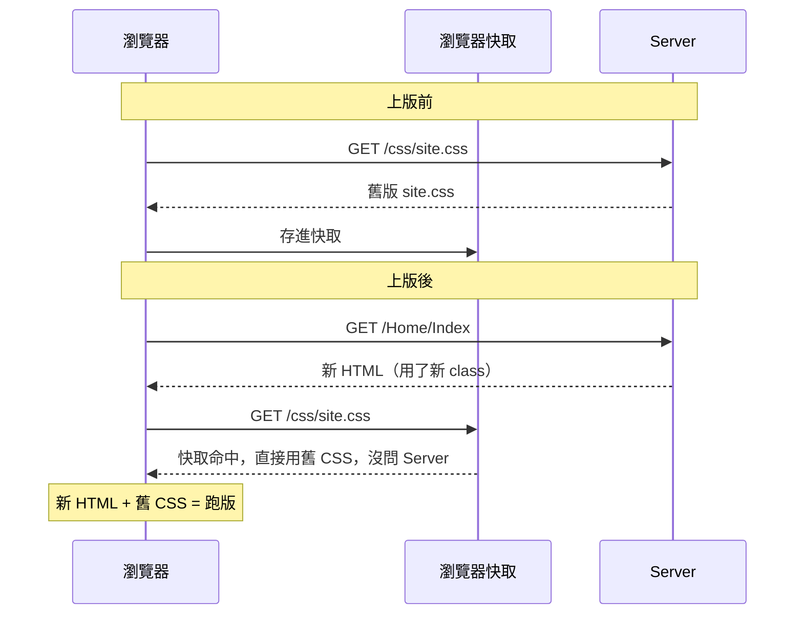
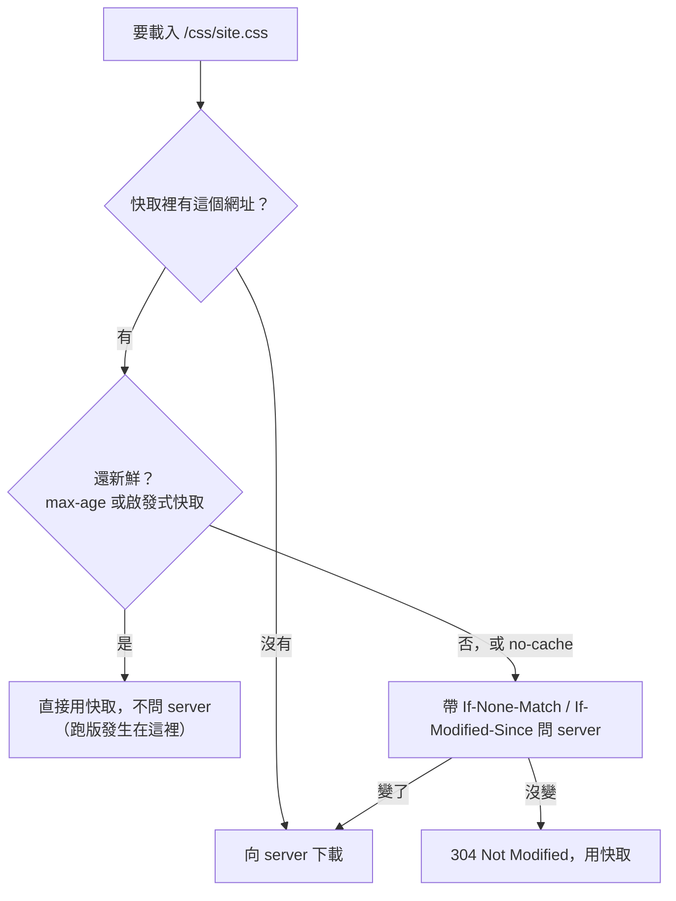

上版後畫面**跑版**，使用者按 `Ctrl+F5` 或清快取就好了——典型的**靜態檔快取**問題：HTML 是新版，CSS/JS 卻是瀏覽器快取裡的舊版，新的 class 對不上舊的樣式。不能要求每個使用者自己清快取，要讓網站上版後**自動**拿到新檔。

## 問題：新 HTML 配舊 CSS



## 原理：瀏覽器用網址當快取 key

瀏覽器快取以**網址**為 key。網址沒變，瀏覽器就認為是同一個檔案，要不要重新跟 server 要，由**當初下載時回應帶的 header** 決定：

| Header | 作用 |
| --- | --- |
| `Cache-Control: max-age=N` | N 秒內直接用快取，**完全不問** server |
| `Cache-Control: no-cache` | 可以存，但**每次使用前都要問** server 有沒有變 |
| `Cache-Control: no-store` | 完全不存 |
| `ETag` / `Last-Modified` | 問 server 時的比對依據（瀏覽器送 `If-None-Match` / `If-Modified-Since`），沒變回 `304 Not Modified`（不傳內容） |

注意 **`no-cache` 不是「不快取」**，而是「用之前要先驗證」。

IIS 與 ASP.NET Core `UseStaticFiles` 的靜態檔預設只回 `ETag`、`Last-Modified`，**沒有 `Cache-Control`**。這時瀏覽器會用**啟發式快取**：server 沒說能快取多久，瀏覽器就自己估一段新鮮期，期間內不問 server 直接用。常見算法是「下載當下距離 `Last-Modified` 的 10%」——越久沒改的檔案，越被認為短期內也不會改。

舉例：使用者 3/31 下載 `site.css`，它的 `Last-Modified` 是 3/1（30 天沒改），瀏覽器就認定它 3 天內都新鮮（30 天 × 10%），到 4/3 前都不問 server。你 4/1 上版改了 `site.css`，使用者 4/2 開頁面拿到新 HTML，CSS 卻還是快取裡的舊版——上版後跑版就是這樣來的。



解法有兩個方向：

1. **叫瀏覽器每次都問**：設 `no-cache`。
2. **內容變了就換網址**：網址加版本號（cache busting），新網址 = 快取裡沒有 = 一定下載新檔。

## 做法一：IIS `clientCache` 停用快取（簡單但有代價）

.NET Framework 網站跑在 IIS，可以在 `web.config` 設定 IIS 的 `clientCache`：

```xml
<configuration>
  <system.webServer>
    <staticContent>
      <clientCache cacheControlMode="DisableCache" />
    </staticContent>
  </system.webServer>
</configuration>
```

IIS 回傳靜態檔時會帶 `Cache-Control: no-cache`，瀏覽器每次使用都會先問 server，檔案有變一定拿到新的。

**注意**：這個 header 只對**設定之後才下載**的檔案有效。使用者快取裡已經有、而且瀏覽器認為還新鮮的舊檔，在新鮮期過之前瀏覽器根本不會發請求，也就收不到新 header。所以它主要防的是**之後**的上版；**這一次**已經跑版的使用者，要等手上舊檔的新鮮期過了才會恢復。

只想套用在特定資料夾，用 `<location>` 包起來：

```xml
<location path="Content">
  <system.webServer>
    <staticContent>
      <clientCache cacheControlMode="DisableCache" />
    </staticContent>
  </system.webServer>
</location>
```

`cacheControlMode` 可用值：

| 值 | 效果 |
| --- | --- |
| `NoControl` | 不加 header（預設） |
| `DisableCache` | `Cache-Control: no-cache` |
| `UseMaxAge` | `Cache-Control: max-age=...`，搭配 `cacheControlMaxAge="7.00:00:00"` |
| `UseExpires` | `Expires` header，搭配 `httpExpires` |

**優點**：只改設定，不動程式碼；舊快取過期後，之後每次上版都拿得到新檔。

**代價**：每個 CSS/JS **每次載入頁面都多一次來回**。沒變雖然只回 304、不傳內容，但檔案多、網路延遲高（行動網路、跨國）時，頁面載入會明顯變慢。

### ASP.NET Core 的對應做法

`clientCache` 是給 **IIS 自己的靜態檔處理**用的。ASP.NET Core 掛在 IIS 後面時，request 會交給 ASP.NET Core Module 轉進 app，靜態檔由 app 的 `UseStaticFiles` 回應，所以這段設定**通常不會作用**。Core 要在 `StaticFileOptions.OnPrepareResponse` 自己加 header（改的是 `Program.cs`；.NET 6 之前的範本（含 .NET 5）是 `Startup.cs`。不是設定檔）：

```csharp
app.UseStaticFiles(new StaticFileOptions
{
    OnPrepareResponse = ctx =>
    {
        ctx.Context.Response.Headers["Cache-Control"] = "no-cache";
    }
});
```

## 做法二：網址加版本號（推薦）

讓網址帶上版本號：

```html
<link rel="stylesheet" href="/css/site.css?v=abc123" />
```

檔案內容一變，版本號就變，網址跟著變，瀏覽器快取裡沒有這個網址，只能下載新檔。內容沒變，網址不變，照常使用快取。兼顧「一定拿到新檔」與「快取效能」。

而且**立刻生效**：MVC 頁面是動態產生的，回應沒有 `Last-Modified`，瀏覽器不會拿它做啟發式快取，每次都會跟 server 拿新 HTML（前提是中間沒有 output cache、CDN 或反向代理把 HTML 也快取起來）。新 HTML 裡就是新網址，連已經跑版的使用者，下一次載入頁面就會正常。

版本號由框架**依檔案內容自動產生**，view 裡只寫檔案路徑。

### ASP.NET Core MVC：`asp-append-version`

Core 內建 Tag Helper，加一個屬性就好：

```html
<link rel="stylesheet" href="~/css/site.css" asp-append-version="true" />
<script src="~/js/site.js" asp-append-version="true"></script>

```

輸出：

```html
<link rel="stylesheet" href="/css/site.css?v=Kl_dqr9NVtnMdsM2MUg4qthUnWZm5T1fCEimBPWDNgM" />
```

- `v` 是**檔案內容的 SHA256 hash**，內容沒變 hash 不變，快取照樣有效。
- hash 算過會快取在記憶體，並監聽檔案變動，不會每次 request 都重算。
- 只對 **`wwwroot` 裡的本機檔案**有效，CDN 等外部網址不會加。
- 需要 `_ViewImports.cshtml` 有 `@addTagHelper *, Microsoft.AspNetCore.Mvc.TagHelpers`（範本預設就有）。

### .NET Framework MVC：Bundling

用 `System.Web.Optimization`（NuGet：`Microsoft.AspNet.Web.Optimization`），在 `BundleConfig` 定義 bundle：

```csharp
public class BundleConfig
{
    public static void RegisterBundles(BundleCollection bundles)
    {
        bundles.Add(new StyleBundle("~/Content/css").Include(
            "~/Content/bootstrap.css",
            "~/Content/site.css"));

        bundles.Add(new ScriptBundle("~/bundles/site").Include(
            "~/Scripts/site.js"));
    }
}
```

在 `Global.asax.cs` 的 `Application_Start` 註冊（MVC 範本預設已有這行）：

```csharp
protected void Application_Start()
{
    // ...
    BundleConfig.RegisterBundles(BundleTable.Bundles);
}
```

`Views/web.config` 的 `<namespaces>` 要有 `System.Web.Optimization`，view 裡才認得 `Styles`、`Scripts`（範本預設也有）：

```xml
<system.web.webPages.razor>
  <pages pageBaseType="System.Web.Mvc.WebViewPage">
    <namespaces>
      <add namespace="System.Web.Optimization" />
    </namespaces>
  </pages>
</system.web.webPages.razor>
```

View 改用 `Render`：

```html
@Styles.Render("~/Content/css")
@Scripts.Render("~/bundles/site")
```

輸出：

```html
<link href="/Content/css?v=WMr1H2Ls1PWQGlIMm-mDZaHkRw8ztSgaw7dMPkuTCDs1" rel="stylesheet"/>
```

`v` 是 bundle 內容的 hash，任何一個檔案改了就會變。

**注意**：只有**開啟最佳化**時才會合併檔案、加版本號。`web.config` 的 `<compilation debug="true">` 時會輸出個別檔案、**不加版本號**。正式環境要確認 `debug="false"`，或在 `BundleConfig` 強制開啟：

```csharp
BundleTable.EnableOptimizations = true;
```

**CSS 相對路徑**：CSS 裡的 `url(../images/bg.png)` 是相對於**瀏覽器看到的網址**解析的，bundle 後網址變成 bundle 名稱。bundle 名稱要跟 CSS 檔所在資料夾同一層，例如 `~/Content/site.css` 就用 `~/Content/css`，不要取 `~/bundles/css`，否則背景圖、字型會找不到。

CSS 分散在不同層的資料夾、沒辦法共用一個 bundle 名稱時，改用 `CssRewriteUrlTransform`，它會把 CSS 裡的相對路徑改寫成絕對路徑，bundle 叫什麼名字都不影響：

```csharp
bundles.Add(new StyleBundle("~/bundles/css")
    .Include("~/Content/site.css", new CssRewriteUrlTransform())
    .Include("~/Content/themes/base/jquery-ui.css", new CssRewriteUrlTransform()));
```

**`.min` 檔優先**：開啟最佳化時，若同資料夾有 `site.min.css`，bundle 會**優先用 `.min` 檔**而不是 `site.css`。只改了 `site.css` 卻沒重新產生 `.min` 檔，上版後還是舊樣式。

## 比較與選擇

| 做法 | 改動 | 一定拿到新檔 | 效能 | 適用 |
| --- | --- | --- | --- | --- |
| IIS `DisableCache` / Core `no-cache` | IIS 改 `web.config`；Core 改 `Program.cs` | 是（使用者舊快取過期後） | 每次多一次來回 | 不方便改 view 的專案 |
| Core `asp-append-version` | view 加屬性 | 是 | 好 | ASP.NET Core 首選 |
| Framework Bundling | 改 `BundleConfig` 與 view | 是（需開最佳化） | 好 | .NET Framework 首選 |

建議：

- **優先用版本號**：Core 用 `asp-append-version`，Framework 用 Bundling。改完上版立刻生效，快取效能也不受影響。
- **改不了 view 才用 `DisableCache`**：不用動 view，但要等使用者手上的舊快取過期後才完全生效，而且每次載入都多一次來回。

## 參考資料

- [RFC 9111: HTTP Caching](https://www.rfc-editor.org/rfc/rfc9111)（4.2.2 節為啟發式新鮮期）
- [HTTP caching - MDN](https://developer.mozilla.org/en-US/docs/Web/HTTP/Guides/Caching)（Heuristic caching 一段，同樣舉 10% 為例）
- [Cache-Control - MDN](https://developer.mozilla.org/en-US/docs/Web/HTTP/Reference/Headers/Cache-Control)
- [Client Cache &lt;clientCache&gt;](https://learn.microsoft.com/iis/configuration/system.webserver/staticcontent/clientcache)
- [Static files in ASP.NET Core](https://learn.microsoft.com/aspnet/core/fundamentals/static-files)
- [ASP.NET Core Module (ANCM) for IIS](https://learn.microsoft.com/aspnet/core/host-and-deploy/aspnet-core-module)（request 由 ANCM 轉給 app 處理）
- [Tag Helpers in ASP.NET Core](https://learn.microsoft.com/aspnet/core/mvc/views/tag-helpers/intro)（`_ViewImports.cshtml` 的 `@addTagHelper`）
- [Script Tag Helper in ASP.NET Core](https://learn.microsoft.com/aspnet/core/mvc/views/tag-helpers/built-in/script-tag-helper)（`asp-append-version`）
- [Image Tag Helper in ASP.NET Core](https://learn.microsoft.com/aspnet/core/mvc/views/tag-helpers/built-in/image-tag-helper)（hash 快取與檔案監聽；文件寫 Sha512，實作是 SHA256）
- [DefaultFileVersionProvider.cs](https://github.com/dotnet/aspnetcore/blob/main/src/Mvc/Mvc.Razor/src/Infrastructure/DefaultFileVersionProvider.cs)（`asp-append-version` 的實作，`SHA256.HashData`）
- [Bundling and Minification](https://learn.microsoft.com/aspnet/mvc/overview/performance/bundling-and-minification)
