你跟 Claude Code 說一句「幫我加一個匯出報表的功能」，幾分鐘後它回報完成。程式跑得起來，畫面上也有那顆按鈕，但仔細看下去，通常會撞上三個問題。

第一個是**醜**。那是為了「能動」硬湊出來的東西：明明專案裡有現成的工具函式，它自己重寫一個；該查設定的地方直接寫死；遇到問題不解決，而是繞過去。跑得起來，但不像正常人會寫出來的東西。

第二個是**沒顧及整體**。它只盯著你交代的那個小需求，沒顧到整個專案。單獨看沒問題，放回系統裡就出事：改了共用函式沒管其他呼叫端、加了欄位沒同步到別的流程、跟既有邏輯撞在一起。

第三個最麻煩：**能動，但功能是假的**。表面上跑得通，實際上沒做事——回傳寫死的假資料、錯誤直接吞掉當成功、測試改成一定會過。你以為完成了，其實只是看起來完成。

根本原因很簡單：**它在猜。** 沒有記憶、沒有專案脈絡、急著交付，你給一句話，剩下的九成它自己補，補出來的東西不一定跟你腦中的一樣。

所以**解法是給它一份規格，讓它有東西可以對照。** 沒有規格，你只能一直來回校正——寫完看一眼、覺得不對、講一句再改，反覆磨。有規格，它一開始就不太會跑偏。

[Superpowers](https://github.com/obra/superpowers) 做的就是這件事。它是一個 plugin，把一整套軟體開發方法論寫成十來個 skill，從需求釐清、拆計畫、實作、審查到分支收尾，每個環節一個 skill；除了 Claude Code，也支援 Codex、Cursor、Gemini CLI、GitHub Copilot CLI 等環境。它強迫流程先產出兩份文件——**設計文件與實作計畫**——再開始寫程式碼。這兩份文件在三個時間點各有作用：

- **寫之前**：逼你把想法講清楚，模糊的地方在文件階段就會被問出來
- **寫的時候**：每個 subagent 拿到的是明確規格，不是靠猜
- **寫完之後**：code review 對照計畫檢查，有客觀依據可以判斷「這是不是我要的」

在 Claude Code 裡用 `/plugin install superpowers@claude-plugins-official` 就能安裝。它改版很快，本文內容以 2026-11-03 發布的 v7.0.2 為準，之後的變動可以看 [Release Notes](https://github.com/obra/superpowers/blob/main/RELEASE-NOTES.md)。

## 先備知識

整套流程建立在兩個 Claude Code 的機制上：skill 與 subagent。先把這兩個講清楚，後面的步驟才看得懂。

### Skill

Skill（Agent Skill）是 Anthropic 在 2025 年 10 月推出的機制，同年 12 月公開成[開放標準](https://agentskills.io)。**一個 skill 就是一個資料夾**，裡面必備一份 `SKILL.md`，分成兩部分：YAML frontmatter 放 `name` 和 `description`，回答「**什麼時候**該用這個 skill」；Markdown 正文回答「**該怎麼做**」。

```markdown
---
name: commit-message
description: 當使用者要 commit、或請你寫 commit message 時使用
---

# Commit message 格式

用 Conventional Commits：`<type>(<scope>): <subject>`

- type 只用 feat / fix / refactor / docs / test / chore
- subject 用祈使句，不加句號，不超過 50 字元
- 破壞性變更在 body 加 `BREAKING CHANGE:` 開頭的段落

範例：`feat(auth): add refresh token rotation`
```

它的用途是**把做事的方法固定下來**。不然同一個需求問兩次，它可能給你兩種實作——這次用 A 套件、下次自己刻。skill 就是把「這件事我們這裡是這樣做的」寫成檔案，讓每次都走同一條路。

讀取分兩層。平常只有每個 skill 的 `name` 和 `description` 會放進 context；判斷跟當下的工作相關時，才把整份 `SKILL.md` 讀進對話。所以裝十幾個 skill，常駐的成本也只有這些簡短的描述，而不是把十幾份完整文件全塞進去。不過這些描述每一輪都佔著 context，沒在用的 skill 還是該移除。

也因為這樣，**`description` 是最重要的一行**。它是路由規則，要寫「什麼情況下該用」，不是「這個 skill 是什麼」：

- ❌ `commit message 格式規範`
- ✅ `當使用者要 commit、或請你寫 commit message 時使用`

另外，`description` 在 Claude Code 的 skill 清單裡超過 1,536 字元會被截斷（連同選填欄位 `when_to_use` 一起算），關鍵的使用時機要寫在最前面。

Claude Code 最常用的 skill 來源有三個：使用者層級（`~/.claude/skills/`）、專案層級（`.claude/skills/`），以及 plugin 帶進來的。此外還有企業管理設定、子目錄裡的 `.claude/skills/` 等來源。

### Subagent

subagent 是主 session 另外開出來的**一個獨立 Claude 實例**。它在自己的 context 裡工作，搜尋結果、log、翻過但用不到的檔案內容都留在那邊，結束時只回傳一份結論給主對話。

這樣做是為了**避免 context 污染**。不然那些你之後不會再看的東西會一直佔著空間，讓後面的工作品質下降。

## 五步驟工作流

整條流程長這樣。藍色是 Superpowers 的 skill，灰色是流程自動跑的環節，綠色虛線框是我自己加的步驟，橘色是要你確認的關卡。

```mermaid
flowchart TD
    A([需求]) --> B["1 · brainstorming<br/>提問釐清 → 提方案 → 產出設計文件"]
    B --> C{設計核准？}
    C -->|退回修改| B
    C -->|通過| D["2 · writing-plans<br/>拆成任務，記下實作需要的決策"]
    D --> P{審計畫<br/>選執行方式}
    P -->|修改| D
    P -->|Subagent-driven| T
    P -->|Native| N["3 · executing-plans<br/>同一個 session 自己做完所有任務"]

    subgraph SDD["3 · subagent-driven-development"]
        direction TB
        T["取下一個任務"] --> IMPL["派全新 subagent 實作<br/>乾淨 context"]
        IMPL --> RV{任務審查<br/>規格符合度 + 程式碼品質}
        RV -->|沒通過| IMPL
        RV -->|都通過| NEXT{還有任務？}
        NEXT -->|有| T
    end

    NEXT -->|沒有| FR{整體審查<br/>全部 commit 對照計畫}
    N --> FR
    FR -->|有問題| FIX1["修正一輪<br/>不重跑整體審查"]
    FIX1 --> V
    FR -->|通過| V["4 · 瀏覽器實測<br/>AI 操控真實瀏覽器點一遍"]
    V --> W{行為符合預期？}
    W -->|不符| FIX2["修正"]
    FIX2 --> V
    W -->|符合| I["5 · finishing-a-development-branch"]
    I --> J([merge / 開 PR / 保留分支])

    classDef decision fill:#3a2a12,stroke:#e8890c,stroke-width:2px;
    classDef skill fill:#1a2740,stroke:#5b8def,stroke-width:1px;
    classDef auto fill:#26262b,stroke:#8b8b93,stroke-width:1px;
    classDef custom fill:#1d2e1a,stroke:#6fbf5f,stroke-width:1px,stroke-dasharray: 4 3;
    class C,P decision;
    class B,D,N,I skill;
    class T,IMPL,RV,NEXT,FR,W,FIX1,FIX2 auto;
    class V custom;
```



### 1. brainstorming

它先讀專案和你指定的文件，**只有在答案會改變要做的東西、而且你的需求和專案裡都找不到答案時才問你**，一次一個。如果你沒說為什麼要做這件事，這會是第一個問題；其他決定它自己下，當成提案讓你糾正。想清楚之後提出 2–3 個方案並給出推薦，由你選一個，最後寫成設計文件（spec）存檔並 commit，**你核准之前不會動手實作**。

文件多詳細看規模：需求已經完整的小事（例如改圖示顏色）它直接做；小改動寫一份簡短的設計文件；專案級的工作寫完整設計文件，交給你之前還會派一個全新的 subagent，用實作者的角度讀過一遍，把缺的資訊補上，非你回答不可的問題才整理起來問你一輪。如果不是你主動叫它，它也會提議可以跳過提問直接開始。

這份 spec **一定要仔細審**。後面每一步都以它為準，寫錯什麼就會被忠實地做出來，而這裡是整條流程裡修改成本最低的時刻。

有個選配的做法：需要參考很多既有檔案時，先開 plan mode（Claude Code 內建的規劃模式，後面會再介紹）讓它讀一輪 codebase 再進來。plan mode 把研究工作交給內建的唯讀 Plan subagent，在獨立 context 裡翻檔案、grep、讀程式碼，回來的是整理過的結論。brainstorming 本身也會先把相關程式碼讀過才開口，所以只有範圍很大、不想讓大量搜尋結果佔住主對話時，才值得多這一步。

### 2. writing-plans

這一步把 spec 展開成實作計畫（plan）。先規劃檔案結構，再拆成一連串任務，每個步驟是**一個動作、結果可以檢查**，例如「寫失敗的測試」「跑測試確認它失敗」「commit」。

plan **只記實作者自己決定不了的東西**：確切檔案路徑、函式簽章、測試名稱與斷言、spec 裡的數值、驗證指令與通過時的輸出。函式本體通常留給實作者寫，只有簽章和測試決定不了的演算法才會寫出來。另外還有一段 Review Focus，列出最多五個 spec 隱含、但任務的測試還沒涵蓋的輸入或失敗情境，並把對應的測試加進負責的任務。

**這份 plan 也要看過。** 它存檔之後會停下來，請你確認內容符合你要的，並選擇執行方式（下一節的 Subagent-driven 或 Native），同時依這份計畫給出推薦。方向上的問題應該在上一步的 spec 就解決，這裡看的是任務有沒有漏、範圍有沒有跑掉，不必逐行讀。

### 3. 執行計畫

執行計畫有兩個 skill 可選，差別在要花多少成本換審查。開始前都會先用 `using-git-worktrees` 準備隔離的工作區，實作時則由 `test-driven-development` 要求先寫失敗的測試。

**`subagent-driven-development`** 逐項派出全新的 subagent 實作，每完成一項就派一個審查 subagent，同時檢查規格符合度與程式碼品質，兩個判定都通過才換下一項。這樣每個任務都在乾淨的 context 下做，不被前面的任務干擾；主 session 的 context 也留著做協調。

任務之間它不會停下來問你。計畫有衝突或模糊的地方，它自己裁定並記錄下來繼續做，只有破壞性操作、資安敏感操作、merge 或 push 這類對外動作，以及計畫壞到無法繼續時才會停。

全部任務做完後，它會再派一個審查 subagent 做**整體審查**，交給它這次全部的 commit 範圍與計畫。逐項審查看的是單一任務，這一關看的是整份實作：所有任務加起來，有沒有達成原本要做的事。審查範圍不只比對計畫，還包含程式碼品質、架構、測試、上線準備，回報分成 Critical、Important、Minor 三級。

有問題時，它只派一個 subagent 一次修完所有發現，再針對修正的部分重審一次，沒有第二輪修正；還沒解決的重要問題，會在最後一步提出來給你。它一路上做過的裁定，結束時也會全部列給你看。

**`executing-plans`**（第 2 步選單裡的 Native）不派實作 subagent，由同一個 session 自己逐項實作、跑測試、記錄進度，中途同樣只有上面那四種情況才會停，全部做完才派一個全新的審查 subagent 看整個分支。發現問題也只修一輪，由它自己修，每個修正都要有先失敗再通過的測試，不再重審。它不只是沒有 subagent 時的退路，也是正式的省錢選項：最便宜也最快，代價是到最後才有獨立審查。想要每個任務都有審查關卡，或計畫長到後面的任務會跑在壓縮過的 context 上，就選 `subagent-driven-development`。

### 4. 瀏覽器實測（自訂步驟）

這一步不是 Superpowers 的 skill，是我自己加上去的，而且**只適用於 Web 專案**。

做法是讓 AI 操控一個真正的瀏覽器，照使用者的操作路徑實際點一遍——填表單、送出、看畫面反應、翻 console 有沒有噴錯。用哪個工具都行，只要 AI 能操控就好：agent-browser、Playwright（CLI 或 MCP）、Claude Code 桌面版的 Browser pane 等等，後面「搭配工具」一節會再談。

為什麼要多這一步？因為**前面的審查都在讀程式碼，沒有一道真的把功能操作過。** 而 AI 產出的問題有一大類是開頭說的「能動，但功能是假的」，這種讀 diff 讀不出來，只有實際操作才會現形。

### 5. finishing-a-development-branch

最後一步先跑一次專案的完整測試套件，**全綠才提供 merge / 開 PR / 保留分支三個選項**，並執行你選的那個。丟棄分支不在選單上，只有你明確要求時才會做，而且要你親手打 `discard` 確認。

測試沒過，它就列出失敗項目然後停住，避免壞掉的程式碼被 merge 或送 PR 出去。

## 為什麼不要自己寫

看完流程，可能會想：這些我自己寫幾個 skill 也做得到。但**已經有全世界在維護的成熟工作流了，沒必要自己寫，也不可能寫得比它好。**

Superpowers 在 GitHub 上有三十萬顆以上的星、上百個 issue 和 PR，被回報過問題、改過很多輪；它也跨多個 agent 環境驗證過，不是只在你的機器上會動。那些看起來多餘的細節——為什麼每個步驟只能做一個動作、為什麼每個任務要派全新的 subagent——都是踩過坑之後加上去的，你要自己踩一遍才會知道。

**而且成熟的選擇不只一個**，差別在使用場景。同樣走「先講清楚要做什麼，再開始寫」這條路的還有 [OpenSpec](https://github.com/Fission-AI/OpenSpec)：

| | Superpowers | OpenSpec |
| --- | --- | --- |
| 偏向 | 個人 | 團隊（官方也說適用個人專案；跨 repo 共用規格的 Stores 還在 beta） |
| 管的是 | 你這一輪怎麼做事：brainstorm → plan → 實作 | 規格本身：`/opsx:explore` → `/opsx:propose` → `/opsx:apply` → `/opsx:archive` |
| 文件的定位 | 設計文件是那次的產物 | `openspec/specs/` 放系統現在的事實，`openspec/changes/` 放提案中的變更，完成後更新 specs，並把變更移到 `changes/archive/` |
| 重點 | 讓你自己不要跑偏 | 規格隨專案一起長，變成大家共用的事實來源 |

## 代價與適用邊界

這套流程不是免費的。**Token 消耗顯著增加**，因為有多輪對話、多個 subagent、反覆審查；**時間也顯著增加**，一個五分鐘能改完的東西，走完流程可能要二十分鐘。想省成本可以在第 3 步選 Native。plan 只記決策、不寫出完整程式碼，也省了不少：v6.4.2 改成這樣時，官方重現當初回報的問題，寫計畫的時間剩四分之一、token 約三分之一。

所以它適合多檔案的功能開發、重構、需要長時間自主執行的任務，以及複雜的商業邏輯。不適合的是簡單任務。

需求還沒想清楚的任務也適合，這正是 brainstorming 的主要用途：它會一路問到想清楚為止。如果只是想先試試看，可以請它做 spike，也就是拋棄式的原型，跳過計畫、實作與審查流程，學到的東西再帶回討論。

### 簡單任務用 plan mode 就夠

Claude Code 內建的 plan mode 是輕量的替代方案：Claude 會讀檔案、探索 codebase，然後寫出它打算怎麼改，但不會動到你的原始碼。按 `Shift+Tab` 或在 prompt 前加 `/plan` 就能進入。

## 搭配工具

### AI 可操控的瀏覽器工具

第 4 步需要一個 AI 能操控的瀏覽器。能讓 AI 開頁面、點擊、填表、讀回結果的工具都可以用，例如 [agent-browser](https://github.com/vercel-labs/agent-browser)、[Playwright CLI](https://github.com/microsoft/playwright-cli)、[Playwright MCP](https://github.com/microsoft/playwright-mcp)、Claude Code 桌面版的 [Browser pane](https://code.claude.com/docs/en/desktop)。

Playwright 官方現在建議 coding agent 可以優先考慮 CLI，因為不必把大量工具 schema 和 accessibility tree 載入 context，比較省 token；MCP 則適合需要持續瀏覽器狀態、深入檢視頁面的長時間工作。Browser pane 內建在桌面版，可以截圖、檢查 DOM、點擊、填表，預設每次改動後都會自動驗證，不過 SSH session 用不了。

挑的時候看的是**對 AI 友不友善**：回傳給 AI 的頁面資訊夠不夠精簡、要操作某個元素時好不好指名、能不能讀到頁面上的錯誤。下面用 agent-browser 當具體例子，它是專門給 agent 用的瀏覽器工具。

**用它的理由有兩個：省 token、操作快。** 這兩件事來自三個設計。

第一，**只看畫面上有什麼，不看網頁原始碼**。回傳的是「這是按鈕、寫著 Sign In、可以點」這種資訊，網頁背後那一大包標籤和樣式都不進來。

第二，**每個元素給一個編號**。之後要點它就寫 `click @e2`，不用去描述「第三個 div 裡面那顆藍色按鈕」，也不會描述錯了點不到、還得重看一次頁面。

第三，**瀏覽器一直開著，而且不開視窗**。第一個指令會啟動背景 daemon，之後的指令都接著用同一個瀏覽器，省掉每次重開的等待；預設閒置一小時才會關閉。瀏覽器預設 headless，要看畫面再加 `--headed`。

用 `npm install -g agent-browser` 安裝，第一次再跑 `agent-browser install` 下載 Chrome for Testing。用 `agent-browser open <網址>` 開好頁面之後，三種指令就夠。查看元素：

```console
$ agent-browser snapshot -i
- textbox "Email" [ref=e1]
- button "Sign In" [ref=e2]
```

操作元素：

```console
$ agent-browser fill @e1 "test@example.com"
$ agent-browser click @e2
```

查看錯誤，這是抓「能動但功能是假的」的主力之一：

```console
$ agent-browser errors
TypeError: Cannot read properties of undefined (reading 'id')
    at handleSubmit (app.js:142)
```

`errors` 列的是頁面錯誤，console 訊息則用 `agent-browser console` 看。寫死假資料或把錯誤吞掉不一定會留下錯誤，這類問題要再用 `snapshot` 對照畫面結果。

### ponytail

[ponytail](https://github.com/DietrichGebert/ponytail) 讓 agent 像個懶到極致的資深工程師思考：**最好的程式碼是你根本沒寫的那些。**

它要 agent 動手前先走一道階梯，由上往下問，停在第一個成立的答案：

1. 這東西需要存在嗎？不需要就跳過（YAGNI）
2. 這個 codebase 裡已經有了嗎？有就重用，不要重寫
3. 標準函式庫做得到嗎？
4. 平台原生功能做得到嗎？
5. 已經裝的相依套件做得到嗎？
6. 一行寫得完嗎？
7. 都不行，才寫「能動的最小實作」，有邏輯的話再留一個小測試

重點是**不會跳過前面幾階直接開寫**——那正是 agent 最容易做的事。

但書是：安全性、資料遺失處理、信任邊界的輸入驗證、無障礙，這四類永遠不在可砍名單上。它每次回覆的最後，也會交代跳過或沒檢查什麼，以及你該知道的風險。

## 參考資料

- [Superpowers](https://github.com/obra/superpowers)（[Release Notes](https://github.com/obra/superpowers/blob/main/RELEASE-NOTES.md)）
- [Claude Code](https://code.claude.com/docs/en/overview)：[Skills](https://code.claude.com/docs/en/skills)、[Subagents](https://code.claude.com/docs/en/sub-agents)、[Plan mode](https://code.claude.com/docs/en/permission-modes)、[桌面版 Browser pane](https://code.claude.com/docs/en/desktop)
- [Agent Skills 開放標準](https://agentskills.io)
- [agent-browser](https://github.com/vercel-labs/agent-browser)（[指令列表](https://agent-browser.dev/commands)）
- [Playwright MCP](https://github.com/microsoft/playwright-mcp)
- [Playwright CLI](https://github.com/microsoft/playwright-cli)
- [ponytail](https://github.com/DietrichGebert/ponytail)
- [OpenSpec](https://github.com/Fission-AI/OpenSpec)
